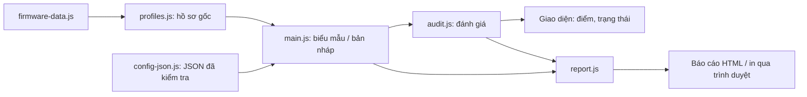

# Mô phỏng đánh giá cấu hình Wi-Fi

Ứng dụng web tĩnh dành cho sinh viên và giảng viên trong đồ án An ninh mạng, giúp đối chiếu cấu hình Wi-Fi gia đình với một bảng kiểm. Người dùng chỉnh hồ sơ mẫu, xem kết quả và khuyến nghị, rồi lưu cấu hình hoặc xuất báo cáo để trình bày.

[](https://github.com/duy13-computer/ceh-v13-module16-wifi-demo/actions/workflows/tests.yml) [](package.json)

## Mục lục

- [Giới thiệu và mục tiêu](#giới-thiệu-và-mục-tiêu)
- [Phạm vi và giới hạn](#phạm-vi-và-giới-hạn)
- [Tính năng chính](#tính-năng-chính)
- [Ảnh minh họa](#ảnh-minh-họa)
- [Bắt đầu nhanh](#bắt-đầu-nhanh)
- [Hướng dẫn sử dụng](#hướng-dẫn-sử-dụng)
- [Kiến trúc](#kiến-trúc)
- [Cách tính điểm và chính sách](#cách-tính-điểm-và-chính-sách)
- [Định dạng JSON cấu hình](#định-dạng-json-cấu-hình)
- [Kiểm thử và CI](#kiểm-thử-và-ci)
- [Bảo mật của ứng dụng](#bảo-mật-của-ứng-dụng)
- [Hạn chế đã biết và hướng phát triển](#hạn-chế-đã-biết-và-hướng-phát-triển)

## Giới thiệu và mục tiêu

Các lựa chọn về bảo mật Wi-Fi, mạng khách và quản trị có thể khó đối chiếu nếu chỉ xem riêng từng thông số. Dự án dùng các tình huống mẫu để minh họa cách đọc cấu hình, nhận biết thông tin còn thiếu và giải thích việc cần khắc phục.

Phạm vi đồ án gắn với nội dung *Wireless Attack Countermeasures* của CEH AI v13, Module 16. Mục tiêu là trình diễn một quy trình đánh giá có thể giải thích và kiểm thử; toàn bộ xử lý chạy trên trình duyệt bằng HTML, CSS và JavaScript thuần, không có backend hoặc cơ sở dữ liệu.

Lịch sử thay đổi được ghi riêng trong [CHANGELOG.md](CHANGELOG.md).

## Phạm vi và giới hạn

> **Đây là ứng dụng mô phỏng, chỉ phục vụ giáo dục và phòng thủ.** Ứng dụng không kết nối hay cấu hình router thật, không quét mạng và không thực hiện kiểm thử xâm nhập. Dữ liệu thiết bị, phiên bản firmware và nguồn đối chiếu đều là giả định.
>
> Điểm số biểu thị mức đáp ứng bảng kiểm của đồ án, không phải chứng nhận an toàn cho mạng thực tế. Kiểm tra tiếp cận tự động cũng **chưa phải chứng nhận WCAG đầy đủ**.

## Tính năng chính

### Sáu tiêu chí đánh giá

| Mã | Tên | Ý nghĩa trong bảng kiểm |
| --- | --- | --- |
| C1 | Chế độ bảo mật | Đối chiếu chế độ đang chọn với mục tiêu WPA3-Personal. |
| C2 | WPS | Ghi nhận cơ chế ghép nối nhanh đã được tắt hay chưa. |
| C3 | PMF | Kiểm tra bảo vệ khung quản lý có ở chế độ bắt buộc hay không. |
| C4 | Cách ly mạng khách | Xem mạng khách có bị cách ly khỏi LAN chính; xác định trường hợp không áp dụng. |
| C5 | Quản trị từ Internet | Đối chiếu với mục tiêu tắt quản trị qua Internet. |
| C6 | Bằng chứng firmware | Kiểm tra thông tin nhận dạng, hỗ trợ và tình trạng cập nhật trong bản ghi mô phỏng. |

### Hồ sơ mẫu

Điểm dưới đây được xác nhận bằng chạy mã và kiểm thử. Đây là cấu hình gốc, trước khi khôi phục bản nháp hoặc nhập JSON.

| Hồ sơ | Tình huống | Điểm mặc định |
| --- | --- | --- |
| A — Cấu hình ban đầu | Chế độ chuyển tiếp WPA2/WPA3, WPS bật, PMF tùy chọn, mạng khách chưa cách ly, thiếu bằng chứng firmware. | **1/6** |
| B — Cấu hình mục tiêu | WPA3, WPS tắt, PMF bắt buộc, cách ly khách, tắt quản trị Internet và có bản ghi B-FW. | **6/6** |
| C — Phương án tương thích | Giữ WPA2 AES/CCMP cho thiết bị cũ, WPS tắt, PMF tùy chọn, mạng khách tắt, thiếu bằng chứng firmware. | **2/5** |

### Công cụ hỗ trợ

| Chức năng | Hành vi hiện có |
| --- | --- |
| Khuyến nghị khắc phục | Tiêu chí cần cải thiện/chưa xác minh có lý do rủi ro, cách xử lý và ưu tiên. Danh sách **Việc cần làm** dùng chung cho giao diện và báo cáo. |
| What-if và đường ngắn nhất | So số tiêu chí đạt với hồ sơ gốc, nêu tiêu chí vừa đổi trạng thái và liệt kê thay đổi tối thiểu theo trường; không tự áp dụng. |
| Cảnh báo nhất quán | Đối chiếu tổ hợp WPA3/PMF, WPS/chế độ bảo mật và quản trị Internet/xác thực mạnh; không đổi điểm. |
| Bằng chứng firmware | Xem bản ghi riêng của A/B/C với các kịch bản thiếu bằng chứng, xác minh hoặc có bản mới. |
| Bản nháp | Lưu riêng từng hồ sơ bằng localStorage; có nút **Xóa bản nháp / khôi phục**. Khi bộ nhớ bị chặn/hết dung lượng, giữ tạm trong phiên. |
| Xuất/nhập JSON | Lưu lựa chọn hiện tại, kiểm tra schema và nhập lại vào hồ sơ nguồn ghi trong tệp. |
| Báo cáo HTML | Tải tài liệu độc lập có điểm, baseline, việc cần làm, cảnh báo và bằng chứng; in hoặc lưu PDF qua chức năng In của trình duyệt. |
| Tiếp cận và giao diện | Nhãn chữ kèm biểu tượng, focus rõ, skip link, bàn phím, bố cục thích ứng, sáng/tối và giảm chuyển động theo hệ điều hành. |

## Ảnh minh họa

Chưa có ảnh minh họa được lưu trong bộ mã nguồn hiện tại. Các đường dẫn sau là **vị trí dự kiến**, chưa được chèn thành liên kết ảnh:

| Đường dẫn dự kiến | Nội dung cần chụp từ ứng dụng thật |
| --- | --- |
| `docs/images/ho-so-a.png` | Hồ sơ A gốc, bảng kiểm và điểm mặc định. |
| `docs/images/what-if-a.png` | A sau tắt WPS và bật cách ly, điểm và chênh lệch baseline. |
| `docs/images/firmware-b.png` | Hồ sơ B với phần bằng chứng B-FW được mở. |
| `docs/images/ho-so-c.png` | Hồ sơ C, trạng thái C4 không áp dụng và mẫu số tương ứng. |
| `docs/images/nhap-json-loi.png` | Thông báo từ chối JSON sai schema, cấu hình đang dùng được giữ nguyên. |
| `docs/images/bao-cao-html.png` | Báo cáo đã tải, gồm điểm, so sánh baseline và việc cần làm. |
| `docs/images/giao-dien-toi-mobile.png` | Giao diện tối ở kích thước màn hình nhỏ, thấy chữ và điều khiển. |

## Bắt đầu nhanh

| Mục đích | Yêu cầu |
| --- | --- |
| Mở ứng dụng | Trình duyệt hiện đại, bật JavaScript và cho phép đọc/tải tệp. Không cần cài Node.js, npm hoặc máy chủ. |
| Chạy kiểm thử | Node.js **>= 20** theo [package.json](package.json), npm và kết nối mạng để tải phụ thuộc/browser khi chưa có cache. |

Mở `index.html` bằng trình duyệt, giữ nguyên vị trí tương đối các tệp. Ứng dụng chạy qua `file://` và có thể dùng ngoại tuyến. Nếu đã có bản nháp, chọn hồ sơ rồi khôi phục để bắt đầu từ cấu hình gốc.

Để kiểm thử, mở terminal **tại thư mục gốc của repo** và chạy theo thứ tự:

```sh
npm ci
npm test
npm run install:e2e
npm run test:e2e
```

Nếu npm không có quyền ghi cache mặc định, dùng lệnh sau **thay cho** `npm ci`:

```sh
npm ci --cache .npm-cache
```

`install:e2e` tải Chromium headless shell vào `node_modules` theo mặc định; không cần Chrome cài sẵn. Chạy lại lệnh này sau khi `npm ci` hoặc xóa/cài lại phụ thuộc. Trên Linux, bước cài thư viện hệ thống được thể hiện trong [workflow CI](.github/workflows/tests.yml).

## Hướng dẫn sử dụng

### Kịch bản trình diễn

| Bước | Thao tác | Kết quả đã kiểm thử |
| --- | --- | --- |
| 1 | Chọn A; xóa bản nháp/khôi phục nếu có. | **1/6**. |
| 2 | Đặt WPS thành **Tắt**. | **2/6**; C2 chuyển sang Đạt. |
| 3 | Giữ mạng khách bật, đặt cách ly thành **Bật**. | **3/6**; C4 chuyển sang Đạt; what-if hiển thị **+2** so với hồ sơ gốc. |
| 4 | Nhấn **Xuất báo cáo HTML**, mở tệp vừa tải. | Báo cáo ghi cấu hình hiện tại, **3/6**, baseline và các việc còn lại. |

Tên báo cáo có dạng `bao-cao-wifi-<hồ-sơ>-<YYYY-MM-DD>.html`. Thời điểm tạo và ngày trong tên tệp theo giờ Việt Nam, lấy từ đồng hồ thiết bị. Dùng chức năng In của trình duyệt để in hoặc chọn lưu PDF; ứng dụng không xuất PDF trực tiếp.

### What-if và gợi ý

Baseline luôn là hồ sơ gốc, kể cả khi mở bản nháp. Chênh lệch tính theo **số tiêu chí đạt**; nếu số tiêu chí áp dụng thay đổi, giao diện ghi riêng mẫu số. Nhấn **Gợi ý đường ngắn nhất tới điểm tối đa** để xem danh sách và tự chỉnh từng trường.

| Từ hồ sơ gốc | Số thay đổi gợi ý đã chạy kiểm tra | Mục tiêu trong mô phỏng |
| --- | --- | --- |
| A | **5**: WPA3, tắt WPS, PMF bắt buộc, cách ly khách, chọn bằng chứng firmware xác minh. | **6/6** |
| B | **0** | Đã **6/6** |
| C | **3**: WPA3, PMF bắt buộc, chọn bằng chứng firmware xác minh. | **5/5**, giữ mạng khách tắt |

Gợi ý giữ trạng thái bật/tắt mạng khách đã xác nhận. Nếu chưa rõ trạng thái mạng khách, cần xác minh trước khi kết luận số thay đổi tối thiểu. Chọn bằng chứng xác minh trong demo không cập nhật firmware thật.

### JSON, bản nháp và bàn phím

| Thao tác | Cách dùng |
| --- | --- |
| Xuất JSON | Nhấn **Xuất cấu hình JSON**; tệp tải về có dạng `cau-hinh-wifi-<hồ-sơ>.json`. |
| Nhập JSON | Chọn tệp tại **Nhập cấu hình JSON từ tệp**. Tệp hợp lệ thay lựa chọn và bản nháp của hồ sơ nguồn; tệp sai được báo lỗi, không đổi cấu hình đang dùng. |
| Khôi phục | **Xóa bản nháp / khôi phục** chỉ tác động hồ sơ hiện tại. Bảng so sánh hồ sơ gốc không thay đổi theo bản nháp. |
| Bàn phím | Tab/Shift+Tab di chuyển, Enter/Space kích hoạt theo hành vi trình duyệt. Khi nút hồ sơ nhận focus, phím trái/phải và Home/End đổi hồ sơ. |

## Kiến trúc

Các tệp dự án được duy trì như sau; thư mục Git, phụ thuộc và kết quả chạy test không nằm trong cây này:

```text
./
├── .github/workflows/tests.yml  # GitHub Actions: unit/DOM và E2E
├── .gitignore                  # Bỏ qua phụ thuộc, cache và tệp sinh ra
├── index.html                  # Khung giao diện, nhãn và thứ tự script
├── styles.css                  # Bố cục, trạng thái, focus, sáng/tối, chuyển động
├── audit.js                    # Chấm điểm, diễn giải firmware, cảnh báo
├── firmware-data.js            # Bản ghi firmware mô phỏng riêng A/B/C
├── profiles.js                 # Cấu hình gốc A/B/C
├── config-json.js              # Schema, đọc và tạo nội dung JSON
├── recommendations.js          # Khuyến nghị và danh sách việc theo ưu tiên
├── what-if.js                  # So baseline và gợi ý thay đổi tối thiểu
├── main.js                     # Sự kiện, DOM, bản nháp, đọc/tải tệp
├── report.js                   # Tạo báo cáo HTML độc lập, escape dữ liệu
├── package.json                # Scripts, yêu cầu Node và devDependencies
├── package-lock.json           # Khóa phiên bản phụ thuộc
├── playwright.config.cjs       # Cấu hình E2E Chromium
├── scripts/playwright.cjs      # Chạy CLI Playwright, chọn nơi lưu browser
├── tests/
│   ├── audit.test.cjs           # Tiêu chí, firmware, cảnh báo, dữ liệu gốc
│   ├── config-json.test.cjs     # Schema và round-trip JSON
│   ├── recommendations.test.cjs  # Khuyến nghị, ưu tiên và tính bất biến
│   ├── what-if.test.cjs         # Delta, mẫu số, gợi ý và mục tiêu
│   ├── report.test.cjs          # Nội dung, thời gian, escape và CSS in
│   ├── main.test.cjs            # Luồng DOM, tệp, bản nháp và bàn phím
│   ├── helpers/app.cjs          # Nạp HTML/script vào jsdom, mô phỏng API tệp
│   └── e2e/app.spec.cjs         # Luồng file:// trên Chromium thật
├── CHANGELOG.md                # Lịch sử thay đổi
└── README.md                   # Hướng dẫn và phạm vi dự án
```



Giao diện và báo cáo dùng chung logic đánh giá, khuyến nghị và so baseline. Các module nghiệp vụ xuất CommonJS cho Node.js; trên trình duyệt chúng cung cấp API qua `globalThis`.

Thứ tự các script `defer` trong `index.html`:

```text
audit.js → firmware-data.js → profiles.js → config-json.js
         → recommendations.js → what-if.js → report.js → main.js
```

## Cách tính điểm và chính sách

| Trạng thái | Ý nghĩa | Trong mẫu số |
| --- | --- | --- |
| ✓ Đạt | Đáp ứng mục tiêu của tiêu chí. | Có |
| ! Cần cải thiện | Có thông tin xác định chưa đạt mục tiêu hoặc firmware cần xử lý. | Có |
| ? Chưa xác minh | Thiếu, không hợp lệ hoặc mâu thuẫn thông tin để kết luận. | Có |
| — Không áp dụng | Chỉ C4, khi mạng khách được xác nhận tắt. | Không |

```text
Điểm = Số tiêu chí Đạt / (6 − Số tiêu chí Không áp dụng)
```

Các tiêu chí áp dụng có trọng số bằng nhau. C4 chỉ bị loại khi `guest.enabled === false`; chưa rõ mạng khách vẫn tính vào mẫu số. WPA2 AES/CCMP và chế độ chuyển tiếp được ghi nhận cần cải thiện so với mục tiêu WPA3 của đồ án.

### Firmware

`interpretFirmware()` là hàm diễn giải dùng chung cho C6, giao diện và báo cáo.

| Điều kiện | Kết quả |
| --- | --- |
| Thiếu bản ghi hoặc trường nhận dạng bắt buộc; thiếu/rỗng `maintenanceStatus`. | **Chưa xác minh**, kể cả khi phiên bản khớp. |
| Đủ thông tin bắt buộc, trạng thái cập nhật có nội dung, thiết bị được ghi nhận hết hỗ trợ. | Cần cải thiện. |
| Đủ thông tin; còn hỗ trợ; phiên bản đang dùng khớp bản đối chiếu; `maintenanceStatus = up-to-date`. | Đạt. |
| Còn hỗ trợ; phiên bản khác nhau; `maintenanceStatus = update-available`. | Cần cải thiện. |
| Các trường hợp còn lại, gồm thiếu trạng thái hỗ trợ/phiên bản đối chiếu hoặc mâu thuẫn. | Chưa xác minh. |

Bản ghi gồm mã, model, phần cứng, phiên bản đang dùng/đối chiếu, nguồn, mốc kiểm tra và trạng thái hỗ trợ/cập nhật. Kịch bản `missing`, `verified`, `outdated` được định nghĩa riêng theo hồ sơ; mốc T0 và nguồn đều là mô phỏng.

### Cảnh báo nhất quán

| Mã | Điều kiện phát cảnh báo |
| --- | --- |
| `wpa3-pmf` | WPA3-Personal nhưng PMF chưa đặt thành bắt buộc. |
| `wps-security` | WPS bật cùng một chế độ bảo mật có trong bảng kiểm. |
| `remote-auth` | Quản trị Internet bật nhưng `remoteAdminStrongAuth` chưa được xác nhận là `true`. |

Cảnh báo không thay đổi điểm hoặc tự sửa cấu hình. Trường xác thực mạnh chỉ là khai báo mô phỏng; C5 vẫn chỉ đạt khi quản trị Internet tắt.

## Định dạng JSON cấu hình

Ví dụ hợp lệ cho kịch bản A đã chỉnh ở phần hướng dẫn:

```json
{
  "schemaVersion": 1,
  "profileId": "A",
  "config": {
    "mode": "wpa2-wpa3-transition",
    "wps": false,
    "pmf": "optional",
    "guest": { "enabled": true, "isolateLan": true },
    "remoteAdmin": false,
    "remoteAdminStrongAuth": null,
    "firmwareScenario": "missing"
  }
}
```

Mọi trường dưới đây đều bắt buộc; không tự ép kiểu. `null` biểu thị chưa xác minh, không đồng nghĩa với `false`.

| Trường | Kiểu / giá trị được nhận |
| --- | --- |
| `schemaVersion` | Số `1`. |
| `profileId` | Chuỗi `A`, `B` hoặc `C`. |
| `config` | Đối tượng gồm đúng các trường dưới đây. |
| `config.mode` | `wpa3-personal`, `wpa2-wpa3-transition`, `wpa2-personal-aes` hoặc `null`. |
| `config.pmf` | `required`, `optional`, `disabled` hoặc `null`. |
| `config.wps`, `config.remoteAdmin`, `config.remoteAdminStrongAuth` | Boolean `true`/`false` hoặc `null`. |
| `config.guest` | Đối tượng gồm đúng `enabled` và `isolateLan`. |
| `config.guest.enabled`, `config.guest.isolateLan` | Boolean `true`/`false` hoặc `null`. |
| `config.firmwareScenario` | Chuỗi `missing`, `verified` hoặc `outdated`. |

Luồng nhập từ chối tệp lớn hơn **64 KiB**, JSON sai cú pháp, sai cấu trúc/phiên bản, thiếu trường, trường lạ ở bất kỳ cấp được kiểm tra, sai kiểu hoặc giá trị ngoài danh sách. Ví dụ chuỗi `"false"` không phải boolean; bản ghi firmware tùy ý cũng không được nhận. Ứng dụng kiểm tra toàn bộ trước khi nạp và dùng kịch bản firmware của đúng `profileId`.

## Kiểm thử và CI

Kết quả chạy lại khi cập nhật README ngày **21/11/2026**, trên Windows với **Node.js v26.8.2**, **npm 11.19.1**:

| Bộ kiểm thử | Lệnh | Kết quả thực tế | Phạm vi |
| --- | --- | --- | --- |
| Unit và DOM/jsdom | `npm test` | **84 đạt, 0 lỗi, 0 bỏ qua** | Điểm gốc, firmware, cảnh báo, khuyến nghị, what-if, schema JSON, báo cáo/escape, luồng DOM, bản nháp và bàn phím. |
| E2E Playwright | `npm run test:e2e` | **8 đạt** | Chromium thật qua file://: tải/mở báo cáo, localStorage, JSON, bàn phím, sáng/tối, mobile, giảm chuyển động và quét axe-core. |

Lệnh cài và chạy đầy đủ ở [Bắt đầu nhanh](#bắt-đầu-nhanh). `npm test` không chạy E2E. jsdom mô phỏng API tải tệp; E2E lưu tệp thật và kiểm tra cả `console.error` lẫn lỗi JavaScript. Khi chạy axe trên file://, bước preload CSS bằng XHR được tắt để dùng CSS đã nạp, không thay cờ bảo mật browser.

[Workflow Tests](.github/workflows/tests.yml) chạy cho mọi push/pull request, dùng Ubuntu và Node.js 24: cài phụ thuộc → unit/DOM → cài Chromium cùng thư viện hệ thống → E2E. Badge ở đầu README liên kết tới đúng workflow của repo; kết quả chạy tại máy không khẳng định trạng thái chạy trên GitHub.

## Bảo mật của ứng dụng

| Biện pháp trong mã | Phạm vi |
| --- | --- |
| `textContent` và tạo phần tử DOM | Hiển thị dữ liệu, khuyến nghị, cảnh báo và lỗi nhập tệp; không chèn dữ liệu nhập bằng innerHTML. |
| Escape HTML | Báo cáo mã hóa ký tự đặc biệt trước khi đưa dữ liệu vào HTML; mã hồ sơ trong tên tệp được giới hạn ký tự. |
| Schema JSON nghiêm ngặt | Kiểm tra trường, kiểu, enum và giới hạn kích thước trước khi đổi cấu hình. Nội dung nhập không được thực thi. |
| `Object.freeze()` | Bảo vệ hồ sơ gốc, dữ liệu firmware, khuyến nghị và các cấu trúc lồng tương ứng khỏi sửa ngoài ý muốn. |

Mã ứng dụng và luồng nhập JSON không dùng `eval`. Riêng [bộ nạp jsdom](tests/helpers/app.cjs) dùng `window.eval` để chạy script của repo trong kiểm thử; không dùng để thực thi JSON do người dùng nhập. Các biện pháp này được kiểm thử trong phạm vi mô phỏng, không thay thế việc đánh giá bảo mật độc lập.

## Hạn chế đã biết và hướng phát triển

Các hướng dưới đây chưa được triển khai hoặc kiểm chứng đầy đủ:

| Hạn chế hiện tại | Hướng có thể bổ sung |
| --- | --- |
| Firmware, thiết bị và nguồn đều giả định; không kiểm chứng khả năng tương thích thực tế. | Bổ sung tình huống và bằng chứng có nguồn rõ ràng để phục vụ bài học. |
| JSON chỉ nhận A/B/C và kịch bản firmware có sẵn. | Thiết kế schema có phiên bản cho hồ sơ tùy chỉnh. |
| localStorage trên file:// phụ thuộc browser/quyền, bản nháp không đồng bộ giữa thiết bị. | Kiểm tra thêm chính sách lưu trữ và hướng dẫn sao lưu qua JSON. |
| E2E hiện chỉ chạy Chromium. | Thêm kiểm thử Firefox và WebKit. |
| Quét tiếp cận tự động chưa bao phủ trải nghiệm thực tế với trình đọc màn hình. | Đánh giá thủ công và kiểm thử với người dùng. |
| Đã kiểm tra CSS in, chưa xác minh toàn bộ bố cục PDF/trang in. | Bổ sung kiểm tra xuất/in và soát bố cục thủ công. |
